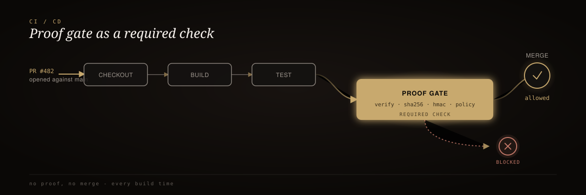

<div align="center">
  
</div>

<br/>

<div align="center">
  <h3>proof-gate-action</h3>
  <p><em>The CI step that catches an AI agent forging "done."</em></p>
</div>

<div align="center">

[](https://github.com/mrodgersjs-web/proof-gate-action/actions/workflows/smoke.yml)
[](https://nodejs.org/)
[](LICENSE)

</div>

<br/>

> 🥇 A GitHub Action that recomputes the HMAC-SHA256 signature over an artifact hash, claimed status, and timestamp - and fails the pipeline the instant it doesn't match.

## 60-second install

Add this step to any workflow that produces a `proofpacket.json`:

```yaml
- name: Proof Gate
  uses: mrodgersjs-web/proof-gate-action@v1
  with:
    proofpacket-path: 'proofpacket.json'
    fail-on-missing: 'true'
    secret-key: ${{ secrets.PROOF_GATE_SECRET }}
```

Sign the packet with the same secret in your build script:

```bash
hmac=$(echo -n "${ARTIFACT_HASH}${STATUS}${TIMESTAMP}" | openssl dgst -sha256 -hmac "$PROOF_GATE_SECRET" | sed 's/^.* //')
```

## How it works

<div align="center">
  
</div>

<sub align="center">build script signs → CI recomputes independently → pipeline stops if it disagrees</sub>

## Benchmark

| Scenario | `fail-on-missing` | Expected result |
| :-- | :-: | :-- |
| Valid signed packet, `BUILD COMPLETE` | `true` | ✅ Pass |
| Artifact hash changed after signing | `true` | ❌ `PROOF GATE FAILED: forged done detected` |
| Signature replaced with random value | `true` | ❌ `PROOF GATE FAILED: forged done detected` |
| Missing packet file | `true` | ❌ `PROOF GATE FAILED: proofpacket not found at ...` |
| Missing packet file | `false` | ✅ Pass (skipped) |

## Why it exists

- **AI agents can lie about done** - `BUILD COMPLETE` can print with failing tests, missing files, or no build at all
- **A claim becomes a cryptographic artifact** - the build signs proof of what it did; CI verifies independently
- **No shared trust required** - the verifier never imports the builder's logic
- **The gate fails the pipeline, not just a log line** - a forged or tampered packet stops the merge

<details>
<summary><strong>Credit-line explanation</strong></summary>

<br/>

The verifier prints a fixed attribution line on every run:

```text
✅ ProofPacket verified by Rodgers Intelligence - github.com/mrodgersjs-web/proof-gate-action
```

This identifies the verification engine and links to the canonical repository so downstream logs always show which gate implementation performed the check.

</details>

## Documentation

| Input | Required | Default | Description |
| :-- | :-: | :-- | :-- |
| `proofpacket-path` | No | `proofpacket.json` | Path to the ProofPacket JSON file |
| `fail-on-missing` | No | `true` | Whether a missing proofpacket fails the step |
| `secret-key` | **Yes** | - | Shared secret used to recompute the HMAC-SHA256 signature |

| Resource | Description |
| :-- | :-- |
| [LICENSE](LICENSE) | MIT |

---

<div align="center"><sub>Built by Mike Rodgers · Forward Deployed Engineer · <a href="https://rodgersintelligence.com">rodgersintelligence.com</a></sub></div>
